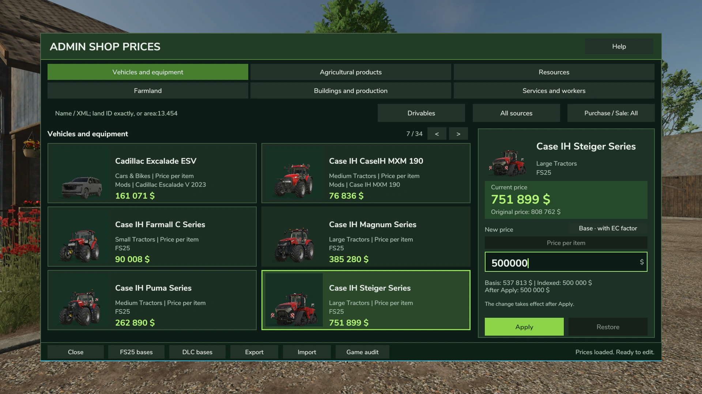
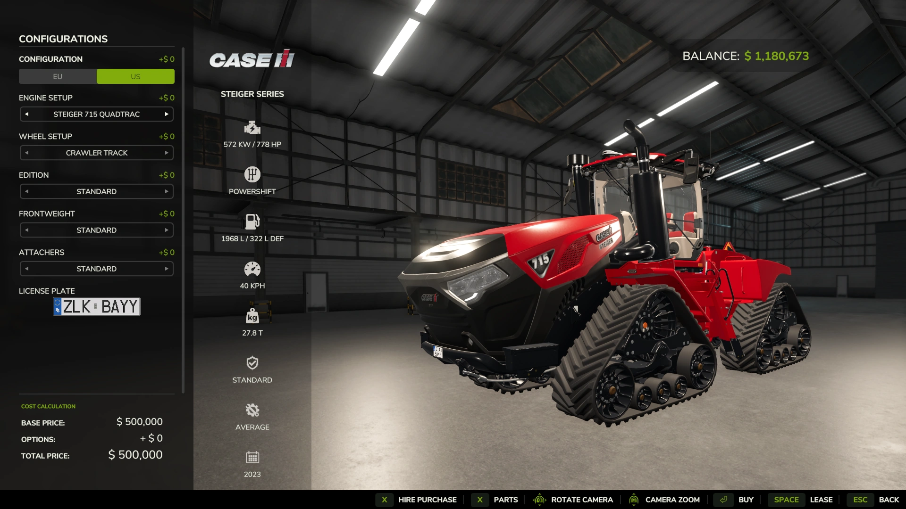
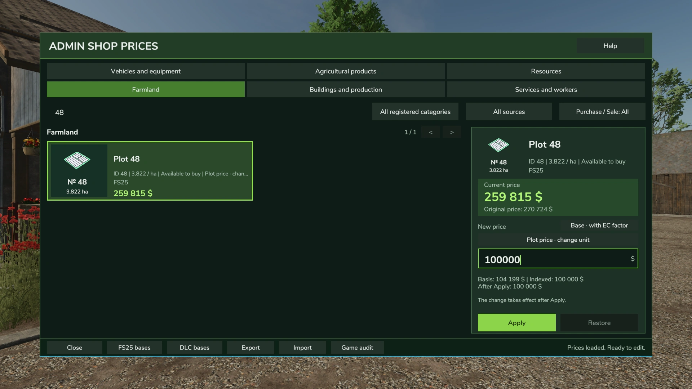
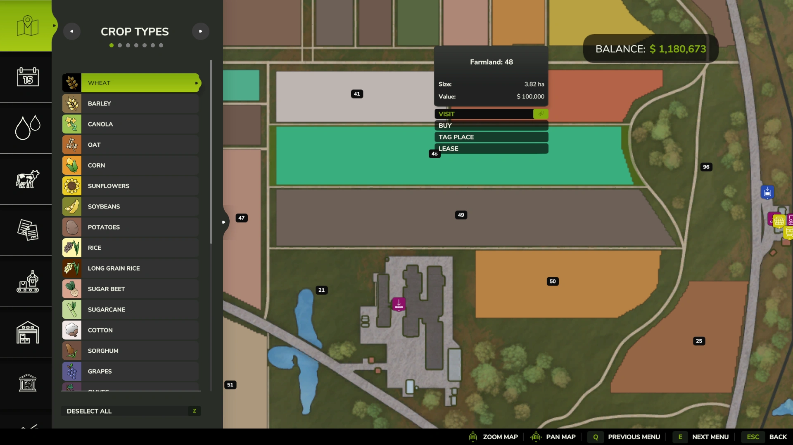
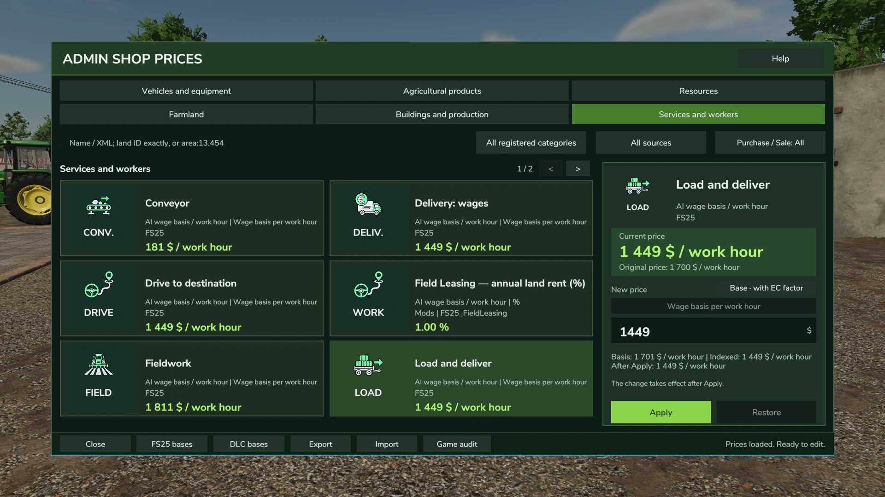
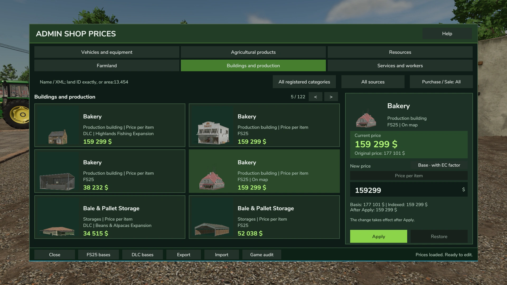

# 🛒 Admin Shop Prices

### Your rules. Your prices. Your Farming Simulator 25 economy.

**In-game price management for Farming Simulator 25**

**[⬇️ Download on KingMods](https://www.kingmods.net/ru/fs25/mods/84435/tseny-magazina-administratora)** · **[🇺🇦 Українською](README.uk.md)** · **[🐛 Report a bug](../../issues/new/choose)**

---

> **Take control of prices across your farm.** Adjust supported prices for vehicles, crops, resources, farmland, buildings, productions and services directly in the game. Fine-tune a few items or build your own economic balance.

## ✨ Features

| Feature | What it does |
|---|---|
| 🛠️ In-game editor | View and adjust supported prices without manually editing mod files |
| 🔎 Search and filters | Find the category and item you want faster |
| 🗂️ Six price categories | Vehicles & equipment, agricultural products, resources, farmland, buildings & productions, services & workers |
| 🔄 Reset and presets | Restore original values or use presets for manual adjustments |
| ⚖️ Separate buy/sell operations | Adjust supported buying and selling prices independently where the game exposes them |
| 🔗 Follow Sale | Link eligible buying prices to selling prices in supported operations |
| 💱 Currency display | Select a display currency without replacing the game's internal payment system |
| 🌍 Economy Control integration | Optional integration; Admin Shop Prices also works independently |

## 🎛️ Price modes

- **BASE:** Manual prices can change along with the relevant economic indices when the optional **Economy Control** mod is installed.
- **FIXED:** Your chosen manual price stays fixed instead of being indexed by Economy Control.

These modes let you combine custom pricing with economic simulation or keep selected values independent.

## 🖼️ In-game screenshots

Real screenshots from **Admin Shop Prices** running in Farming Simulator 25.

### 🚜 Vehicle price: editor → shop

Set the Case IH Steiger base price to **$500,000** in the editor, then see the updated base price in the vehicle shop.

| Edit the price | See the price in the FS25 shop |
|:---:|:---:|
|  |  |

### 🗺️ Farmland: editor → map

Set the price for **Plot 48** to **$100,000** and see that value on the farmland map.

| Edit Plot 48 | Updated farmland map value |
|:---:|:---:|
|  |  |

### 🏭 Services and production buildings

The editor also covers **work and service costs** and **production buildings**, including buildings already placed on the map (indicated by *On map*).

| Services and workers | Buildings and production |
|:---:|:---:|
|  |  |

For downloads and release details, visit **[KingMods](https://www.kingmods.net/ru/fs25/mods/84435/tseny-magazina-administratora)**.

## 📥 Download & installation

1. Download the latest public **Admin Shop Prices** archive from **[KingMods](https://www.kingmods.net/ru/fs25/mods/84435/tseny-magazina-administratora)**.
2. Place the mod `.zip` in your active **Farming Simulator 25** mods folder. Keep it zipped unless the mod's distribution instructions say otherwise.
3. Enable the mod in your save game and launch the game.
4. Locate its controls in the game's controls/settings menu if needed.

> **Important:** This repository is currently a **project hub and support page**, not an alternative download mirror. Use the public KingMods link above. An official ModHub download is not claimed here.

## 🤝 Compatibility & multiplayer

- **Economy Control is optional.** Admin Shop Prices works without it.
- When both mods are installed, compatible price behavior can combine historical economic changes with manual adjustments.
- Multiplayer price changes depend on server permissions.
- Some third-party mods implement their own pricing/payment systems; compatibility with those operations is not guaranteed.

## 🐛 Feedback and bug reports

Found a bug or want to suggest an improvement? Please use [GitHub Issues](../../issues/new/choose) and include:

- Admin Shop Prices version, game version, and whether you play single-player or multiplayer;
- Exact steps to reproduce the issue and the result you expected;
- Whether Economy Control or other economy-related mods are installed;
- Relevant log lines, **with personal or sensitive information removed**.

See **[Support & troubleshooting](SUPPORT.md)** for guidance.

## 🗓️ Latest public changes

**v1.1.0.0** — Expanded editor to six economic categories; added separate buy/sell operations, price modes, presets, improved search and filters, and optional Economy Control integration.

Read the [changelog](CHANGELOG.md) or the [KingMods listing](https://www.kingmods.net/ru/fs25/mods/84435/tseny-magazina-administratora).

## ❤️ Support development

**Admin Shop Prices is free. Donations are optional and do not unlock mods, features, updates or faster downloads.**

If you enjoy the mod and want to support future updates, you can make a completely voluntary donation:

**[❤️ Support development on Donatello](https://donatello.to/MarkusVII)**

You can also help by sharing the mod, reporting bugs, and leaving constructive feedback. Donations do not grant access to exclusive features, updates or downloads.

## 👤 Credits

**Created by MarksuVII** — author as listed on [KingMods](https://www.kingmods.net/ru/fs25/mods/84435/tseny-magazina-administratora).

Farming Simulator and its trademarks belong to their respective owners. This is an independent community mod project.

---

Free for players · Built with community feedback · Not an official GIANTS Software product

