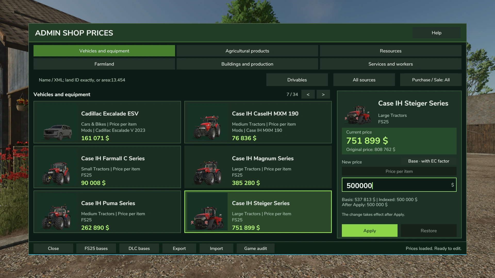
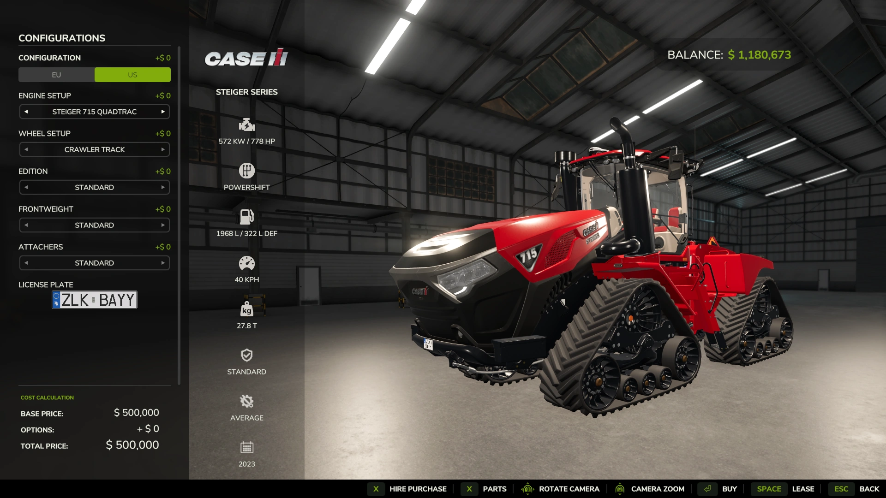
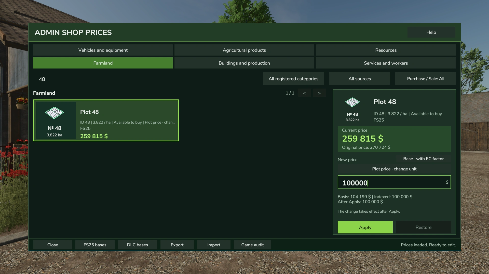
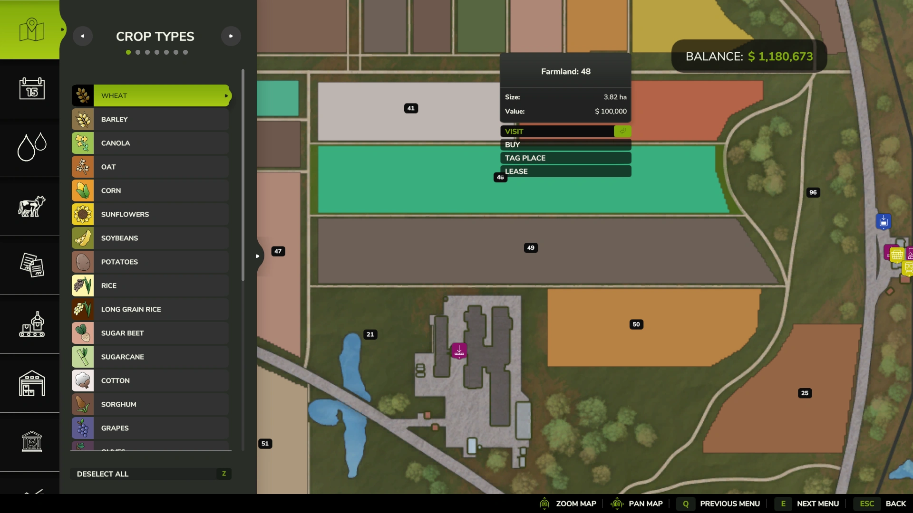
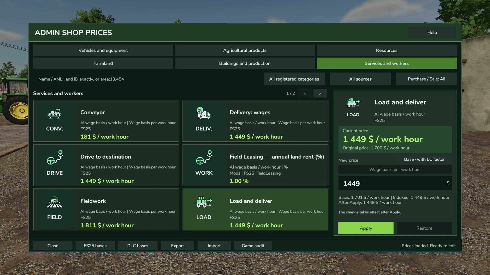
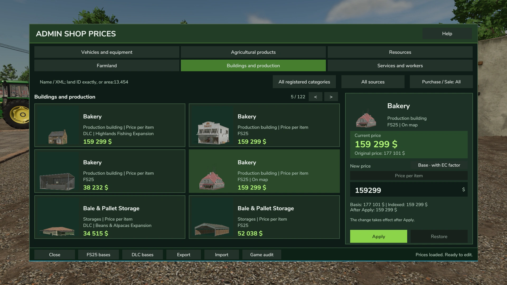

# 🛒 Admin Shop Prices — українською

**Твої правила. Твої ціни. Твоя економіка у Farming Simulator 25.**

**[⬇️ Завантажити на KingMods](https://www.kingmods.net/ru/fs25/mods/84435/tseny-magazina-administratora)** · **[English README](README.md)** · **[Повідомити про проблему](../../issues/new/choose)**

## Що це за мод?

**Admin Shop Prices** дозволяє змінювати підтримувані ціни безпосередньо в грі: від вартості техніки до цін на продукцію та послуги. Є редактор із пошуком, фільтрами, пресетами та можливістю повернути вихідні ціни.

### Шість категорій

- Техніка та обладнання;
- Сільськогосподарська продукція;
- Ресурси;
- Сільськогосподарські угіддя;
- Будівлі й виробництва;
- Послуги та працівники.

### Режими роботи

- **BASE:** налаштована ціна може змінюватися разом з індексами економіки, якщо встановлено **Economy Control**.
- **FIXED:** встановлена вручну ціна залишається фіксованою й не індексується Economy Control.
- **Follow Sale:** у підтримуваних операціях можна пов'язати ціну купівлі з ціною продажу.

Мод **працює самостійно** — Economy Control не є обов'язковим. У мережевій грі можливість змінювати ціни залежить від прав на сервері. Окремі сторонні моди можуть використовувати власні системи ціноутворення.

## 🖼️ Скриншоти з гри

Це справжні кадри роботи **Admin Shop Prices** у Farming Simulator 25.

### 🚜 Ціна техніки: редактор → магазин

У редакторі змінюємо базову ціну **Case IH Steiger** на **500 000 $**, після чого бачимо її в магазині.

| Редактор ціни | Ціна в магазині |
|:---:|:---:|
|  |  |

### 🗺️ Земля: редактор → карта

Для **ділянки №48** встановлено **100 000 $**, і ця вартість відображається на карті.

| Редактор ділянки | Ціна на карті |
|:---:|:---:|
|  |  |

### 🏭 Послуги й виробництва

Редактор також охоплює послуги, робочі операції та виробничі будівлі. Позначка **On map** біля пекарні показує, що об'єкт уже розміщений на карті.

| Послуги та працівники | Будівлі та виробництва |
|:---:|:---:|
|  |  |

## Завантаження

Актуальна публічна версія на момент підготовки сторінки — **v1.1.0.0**. Завантажуй мод зі [сторінки KingMods](https://www.kingmods.net/ru/fs25/mods/84435/tseny-magazina-administratora).

Цей GitHub зараз є **сторінкою проєкту й місцем для повідомлень про помилки**, а не альтернативним джерелом архіву.

## Маєш ідею чи знайшов помилку?

Створи [Issue](../../issues/new/choose) та вкажи версію гри й мода, спосіб відтворення помилки, інші встановлені економічні моди та відповідні рядки логу без приватних даних. Детальніше — у [SUPPORT.md](SUPPORT.md).

## ❤️ Підтримка автора

Мод **безкоштовний**. Донати повністю добровільні й не дають платного доступу, функцій або ранніх оновлень.

**[❤️ Підтримати розробку через Donatello](https://donatello.to/MarkusVII)**

Також можна підтримати проєкт відгуком, повідомленням про помилку або рекомендацією іншим гравцям.

**Автор: MarksuVII** (згідно зі сторінкою на KingMods). Проєкт не є офіційним продуктом GIANTS Software.
